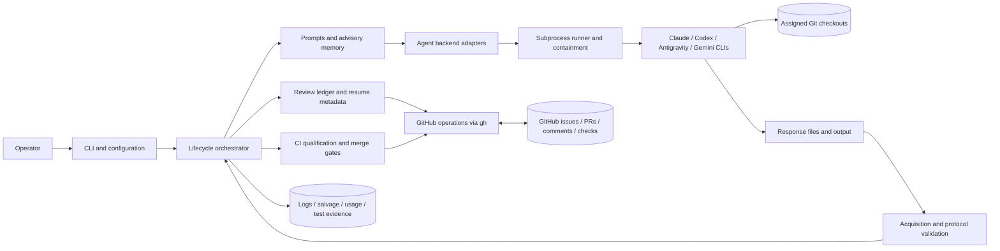

# System boundaries and components

What agent-loop controls and what it delegates to agent CLIs, Git and GitHub; how the sandboxed permission mode and the read-only inspector enforce the role split; and the full per-module ownership table behind the root component map, including the `orchestrator.py` re-export facade and its acyclic module chain.

Source paths: `src/coding_review_agent_loop/agent_permissions.py`, `src/coding_review_agent_loop/inspect_tool.py`, `src/coding_review_agent_loop/orchestrator.py`, `src/coding_review_agent_loop/`, `tests/test_orchestrator_split.py`, `tests/conftest.py`.

## System Boundaries

- The operator supplies roles, model/effort overrides, permissions, workdirs,
  and execution limits. Agents use their own CLI authentication and quotas.
- The coder can edit and test the assigned repository, commit, push, and create
  a PR. The orchestrator validates the reported result and owns normal review
  publication, handoff, scheduling, and finalization.
- Reviewers are instructed to inspect the verified checkout without modifying
  code or running tests. In `default` and `dangerous` permission modes this is
  a command policy, not a universal read-only filesystem sandbox; actual
  enforcement depends on backend permissions and the execution environment.
- `--agent-permissions sandboxed` (`agent_permissions.py`) turns the role split
  into CLI-enforced permission classes built per invocation: only the exact
  `coder` role gets the coder grant (Claude only; a committing Codex coder is
  rejected because its sandbox keeps `.git` read-only), and every other or
  missing role fails closed to read-only. Claude non-coders run with
  `--restricted`, writes limited to the response root, and a single shell
  grant, `agent-loop inspect`; Codex non-coders run in the read-only sandbox,
  with no network, and the Codex CLI writes their response. Gemini and
  Antigravity, and every pass-through `--<agent>-arg`, are rejected at config
  time, with a `run_agent_result` guard as backstop.
- The sandboxed response root is a physically validated boundary: created as
  private, non-symlink components, checked not to overlap any agent checkout in
  either direction, and re-verified (components, checkout identities, overlap)
  immediately before every sandboxed spawn; the per-invocation file is created
  exclusively without following symlinks.
- `agent-loop inspect` (`inspect_tool.py`, standard library only) is the
  read-only git/gh boundary for Claude non-coders. Its argument allowlist,
  forced git config, closed environment allowlist with a `PATH` built from the
  startup-pinned git and gh directories, and repository-config compatibility gate stop
  inherited environment, `PATH` entries, coder-controlled git config
  (filters, diff drivers, gpg programs, includes, aliases, hooks, trace
  targets), and `.gitattributes` from making an inspection run a program or
  write a file. Submodule recursion is forced off (`--ignore-submodules=all`
  plus `-c` overrides), because a populated submodule's own local config lies
  outside the gate. The Git child also enters the command-time execution
  boundary described in [execution and concurrency](execution-and-concurrency.md). agent-loop's own workdir snapshot around a sandboxed
  Claude turn uses the same pinned, gated, hardened git, so it cannot run
  coder-planted config either. Its interpreter (`-I`), package files, and the pinned git and
  gh are fingerprinted at startup and re-verified before each read-only Claude
  spawn; a mismatch is reported as agent-unavailable without spawning.
- Residual: sandboxed coders run tests and `git` (including their own hooks,
  aliases, and checkout-local binaries) as the same OS user. The mode prevents
  accidental and prompt-driven checkout mutation by non-coders and detects or
  refuses between-turn tampering with inspector code, pinned binaries, git
  configuration, and the response root; it is not OS-level isolation from a
  deliberately hostile coder, which could, for example, write to a
  user-writable directory holding a pinned binary between the check and the
  turn. In `default` mode command policy remains the only control.
- Model responses propose verdicts and actions. They are not authoritative Git
  state, CI results, or permission grants.
- The tool publishes reviews as PR conversation comments, not native GitHub
  approving reviews. Model signatures do not create separate GitHub identities
  or satisfy native required-review branch protection.

## Component Map

Source paths below are relative to
[`src/coding_review_agent_loop/`](../../src/coding_review_agent_loop/).

| Responsibility | Main source files | Boundary |
| --- | --- | --- |
| Entry points and effective configuration | `cli.py`, `config.py` | Parse modes; resolve role-specific models, effort, base, and policy before invocation. |
| Lifecycle facade | `orchestrator.py` | Import/re-export facade only: a docstring plus import statements that keep the historical `coding_review_agent_loop.orchestrator` surface (used by `cli.py` and tests) bound to the owning modules below; it defines nothing itself. Together with the rows below it composes planning, implementation, review, recovery, and finalization; control decisions are never delegated to free-form agent prose. |
| Agent failure classification | `agent_failure.py`, `reset_parsing.py` | Validated agent response types, rate-limit reset parsing (the pure parsers live in the stdlib-only leaf module `reset_parsing.py`, which `agent_failure` re-exports and `transient` imports, so `transient` never imports `agent_failure`), transient/unsupported-model classification, structured-candidate recovery, and failed-run diagnostics. |
| Architecture-impact contract | `architecture_contract.py` | Prompt-architecture freezing, PR architecture identity revalidation, and accepted-candidate carriers for the architecture-impact contract. A reviewer whose `architecture_impact.status` is the sole defect in the assessment (absent, null, blank, non-string, or out of enum) is re-asked once with the frozen prompt and session through the single re-ask slot shared with the carried-disposition re-ask, outside retries, Antigravity fallback, and repair. After exhaustion the turn fails as a reviewer failure with repair skipped, and any repair still reached is refused if it introduces a status the source did not decide. |
| Validated agent turn | `validated_agent.py` | Run telemetry and usage contexts, structured repair, completion recovery, and the validated agent turn shared by every role. |
| Response validation | `response_validation.py` | Coder and plan response validators, human-requirement checks, and post-PR test/observation validation. |
| Panel evidence | `panel_evidence.py` | PR/plan panel evidence, board-amendment notes, plan primary streak, and plan-growth gates. |
| Evidence stall | `evidence_stall.py` | Pure evidence-only stall classification: derives the unsatisfied risk-matrix rows from persisted canonical evidence bound to the head and approved matrix identity, classifies a review round (closed reason set), and walks the K-round window; it performs no I/O. The dispatch-path decision and stop message live in `pr_loop_support.py`. |
| Evidence conversion | `evidence_conversion.py` | Pure risk-matrix evidence conversion: decodes the per-attempt capture classification, decides automatic conversion from N consecutive capture-limited attempts paired with their review snapshots, validates operator row lists, encodes and strictly decodes the conversion audit, and reconciles converted obligations to the live head (restore from audit, reopen, tool supersession). It performs no I/O; the dispatch-path conversion, operator path, reference minting and authenticated comment access live in `pr_loop_support.py`. |
| Review step-back | `review_step_back.py` | Pure, history-derived step-back bookkeeping: classifies each primary review from its historical record as `new-finding`, `repeat-only`, or `approved`; derives the trigger streak and the active episode separately; derives the episode anchor (dissolved items and trade-offs from the step-back candidate record) with the planner and reviewer anchor blocks and the declaration-based list of reintroduced dissolved items, and renders the step-back planner guidance, the step-back reviewer notice, and the human-decision stop message. It also derives the growth-independent plan sweep streak through the counted-review walk it shares with the step-back, the shared sweep/export eligibility filter, the sweep request text, and each reviewer's previous-plan provenance baseline (#1505) with its tiered form selector (`select_provenance_baseline`: unified diff, sentence-level compact diff, full previous plan as baseline data, or unavailable, under a plan-relative diff budget and the `--plan-provenance-baseline-max-chars` hard budget; #1516). For the PR fix loop it also projects finding locations, maps anchors across heads from supplied diff text (`SHIFTED`/`REWRITTEN`/`UNMAPPABLE`), clusters findings, applies the shared `in_cluster` membership rule, and renders the coder step-back, reviewer sweep, and sibling-escalation text; the git reads happen in `pr_loop_support.py`. It performs no I/O. |
| Finding history | `finding_history.py` | Advisory, bounded per-run history of earlier rounds' findings (resolved ones included, each with its `path:line` references; CI failures as instances keyed by obligation identity plus failed head) and the agent's own previous fixes. A per-loop in-memory `FindingHistoryLedger` is seeded once from round records the loop already extracted (deferral outcomes replayed read-only by `round_state.canonical_history_item_outcomes`) and updated from the authoritative post-reconciliation ledger; status is never inferred from historical votes. Renders the standing proactive-generalization guidance (always present) plus at most 6 rounds / 6000 characters of history into every planner revision prompt and coder fix prompt (not the merge-conflict prompt), before any step-back text, and logs a declared `Generalization:` tagged proactive or step-back-directed. A failure inside the history degrades to an unavailable notice, never a stop; it performs no I/O and persists nothing. |
| Review rounds | `review_rounds.py` | Review outcome classification, round-ledger helpers, parallel reviewer-turn launch, spool replay, and partial-round refusal. |
| Discuss loop | `discuss_loop.py` | The discuss mode entry point and its consensus and split-proposal analyzers. |
| Execution policy | `execution_policy.py` | Execution-policy resolution, child routing and provenance, staged reporting, typed plan-stage extraction, and fresh-topology preflights. |
| Child plan binding | `child_plan_binding.py` | Inherited-matrix replan state, child-plan rebind and supersession, and structured plan-round assembly. |
| PR loop support | `pr_loop_support.py` | Exact-head merge proof, finalization, evidence freeze, qualification snapshot, and PR transition observation; evidence conversion and signed-evidence references, read through the one authenticated comment accessor `authenticated_pr_comments`. |
| PR review loop | `pr_loop.py` | The PR review loop entry point (`run_pr_loop`). |
| Approved-plan implementation | `issue_implementation.py` | Approved-plan implementation handoff and plan decomposition. |
| Plan-first loop | `plan_first_loop.py` | The plan-first loop together with staged child dispatch and child planning cycles (one mutually recursive group, kept in one module). |
| Issue and task loops | `issue_loop.py` | The issue and task loop entry points. |
| Checkout identity | `workdirs.py`, `workdir_guard.py`, `workdir_claims.py`, `checkout_verification.py` | Prepare assigned checkouts and validate repository/head and reported test locations. `workdir_claims.py` holds a run-scoped cross-process claim on each required checkout (plus a claim probe and run-end finalizers); cleanup and reset happen only under this run's claim. `run_worktrees.py` creates, prunes and removes the per-run worktrees over the shared store. `checkout_verification.py` is the in-process pre-turn gate: it verifies that an assigned checkout still matches what agent-loop last left in it. |
| Agent-facing context | `prompts.py`, `memory.py` | Render issue/plan/human/feedback context and advisory repository orientation. |
| Provider invocation | `agents/base.py`, `agents/registry.py`, provider adapters | Translate a common invocation into backend-specific commands and return `AgentResult` with output, provenance, usage, and failure evidence. |
| Process execution | `runner.py`, `containment.py`, `agents/replacement.py` | Capture subprocess output, enforce supported process-tree limits, and support bounded evidence-based startup recovery. |
| Response contracts and repair | `protocol.py`, `repair.py`, `repair_preservation.py`, `risk_coverage_map.py`, `agents/format_repair.py` | Validate structured responses; accept bounded semantic coverage claims; derive canonical implementation evidence after head authentication; and reject content-loss or semantic rewrites. `risk_coverage_map.py` is the pure, deterministic coverage-map completeness check (every enforceable row claimed or declared a gap, cited test paths are regular files in one pinned commit, declared `test_level` meets the required level), run once by the approved-plan implementation seam with a single pre-review coverage re-ask. Reviewer repair is refused fail-closed when a `plan_review`/`pr_review` source carries no recoverable payload of the expected kind, and a repaired reviewer verdict, finding, or carried disposition must be grounded in the reviewer's own source text; a refusal is a reviewer unavailability, never a synthesized verdict. A repaired reviewer `architecture_impact.status` must likewise be the status the reviewer's own source declared; repair never supplies the decision. The derivation also records a structured per-row capture classification, and `apply_signed_evidence_references` is the only producer of `operator-signed` rows; canonical-evidence parsing refuses provenance keys unless the orchestrator supplies trusted references bound to the row, matrix and head. |
| Finding identity and scheduling | `unresolved_items.py`, `review_scheduling.py`, `plan_review_scheduling.py` | Carry stable findings/dispositions and decide which reviewers must inspect a head or a candidate plan. |
| Declared scope | `scope_declarations.py` | Pure extraction and rendering of operator-declared `Out of scope` / `Non-goals` heading sections from the issue body and signed human comments into a binding-scope prompt block. |
| Durable review transport | `round_state.py`, `round_transport.py`, `comment_rendering.py`, `issue_body_limits.py` | Reconstruct rounds, persist authenticated structured plan/matrix payloads in bounded sidecars, and render readable comments from semantic data. Optional plan telemetry fields (#1505) ride the same records and are omitted when unset: `provenance` and `repeat_of` on minted review items, `plan_sweep` on the swept primary reviewer record, and the `provenance_baseline` form and size (#1516) on plan reviewer records; a malformed value decodes as absent. `issue_body_limits.py` bounds tool-created issue bodies that embed plan-derived text, shortening those sections against a pointer to the canonical source and failing with a surface- and section-specific diagnostic when a body still does not fit. Structured plan coder comments additionally have a bounded visible digest, selected only when the full comment overflows the body budget (see [Compact-on-overflow plan presentation](plan-context-and-presentation.md#compact-on-overflow-plan-presentation)). The visible coder matrix-evidence section is collapsed and, on PR coder follow-ups, projected as a delta against the previous coder round, while canonical evidence stays complete (see [Delta matrix-evidence presentation](plan-context-and-presentation.md#delta-matrix-evidence-presentation)). |
| GitHub and protocol trust | `github.py`, `protocol_markers.py` | Fetch live state and perform controlled writes; separate untrusted text from tool-owned protocol records. Trusted issue-created managed-CI authorization is PR-comment-only. `protocol_markers.py` also owns the deterministic visible-label invariant for tool-owned records, and `github.py` owns the shared write read-back verifier, which tolerates exactly one known host comment footer. |
| Outcome history export | `history_export.py` | Read-only `agent-loop history export`: one versioned (`schema_version` 1) outcome row per issue, derived purely from `github.read_authenticated_protocol_comments` views of the issue and its GitHub-linked closing PRs (only the authenticated actor's comments count), the `round_state` decoders, and plain stop/infrastructure diagnostics recognized through render-side template constants (`PLAN_SCHEDULING_DIAGNOSTIC_TEMPLATE`, `PR_SCHEDULING_DIAGNOSTIC_TEMPLATE`, `PLAN_STEP_BACK_HUMAN_DECISION_PREFIX`, `PLAN_PRIMARY_STALL_PREFIX`, the CI infrastructure headlines, the `review_rounds.INCOMPLETE_PR_REVIEW_*` pieces of the incomplete-review stop, and the agent-unavailable envelope) plus discuss `failed_debaters` on round summaries and classified with the `agent_failure`/`transient` classifiers. Counts are `{value, evidence}` pairs that are `verified` only when a recognized terminal state bounds the history; `step_backs` alone may also be `not-applicable-pre-feature` with value 0 when every counted round's record comments were created and last edited before the step-back feature cutoff (`STEP_BACK_FEATURE_CUTOFF`), while a round that is neither pre-feature nor carries era evidence keeps it `unavailable`; the plan finding provenance columns, `plan_sweep_reviews` (#1505) and the `plan_baselines_*` form columns (#1516) use the `plan_rounds` evidence rule and `review_step_back.eligible_new_mandatory_items`; the run-start snapshot matches `panel_evidence.plan_issue_text_digest_for` against title/body versions rebuilt from GitHub edit history. The GitHub reads (`list_repository_issues`, `read_issue_outcome_history`) live in `github.py`; the command posts nothing, starts no agent and makes no model call. |
| Advisory issue triage | `triage.py`, `usage.py` | `agent-loop issue --triage`: deterministic route signals, leak-free same-repository retrieval over a local `history export` file (outcome complete and snapshot dated before the triage time), default backend selection (primary plan reviewer, else first codex reviewer, else first reviewer; `configured_model_for(..., role='reviewer')` unless `--triage-model`), one validated turn (`prompts.build_triage_prompt`, `response_validation.parse_triage_response`) and an issue comment carrying the orchestrator-only `AGENT_ISSUE_TRIAGE` record. `run_issue_loop` only arms a one-shot `RunUsageContext` hook at its fresh-dispatch point (never for dry runs, fresh decomposition children or existing-PR resumption); `note_agent_dispatch` claims it under `_lock`, runs it outside the lock, lets the owner thread's nested dispatch pass through, and makes sibling dispatchers wait on a completion `Event` set in a `finally`. Triage never reads or changes a routing argument, and every failure is logged and ignored. |
| Offline triage backtest | `triage_backtest.py` | Offline, report-only `agent-loop triage backtest`: reads only local `history export` files (`triage.load_triage_history`; identical duplicate rows collapse, conflicting ones are refused), derives versioned outcome labels from verified measured counts only (`human_decision_stops`, `step_backs`, `plan_rounds`, `pr_rounds`, `merged`; a `step_backs` value of 0 with `not-applicable-pre-feature` evidence also counts, no other column accepts it; gated on `outcome_complete` and complete infrastructure coverage; never `route`, `route_taken` or `terminal_states`), builds one leak-free request per labeled issue at `T = run_started_at` with `triage.retrieve_similar_issues` and `triage.extract_signals` (the target's own snapshot must be dated at or before `T`), and splits issues chronologically into calibration and holdout. The operator's provider command runs once per target without a shell, in a fresh temp directory and its own process group, with GitHub token variables removed, a timeout and stdout/stderr caps; the whole group is terminated on every exit path. Answers are a stage-2 `issue_triage` route answer (`response_validation.parse_triage_response`) or an `issue_triage_probability` answer with explicit abstain; invalid or failed calls count as abstain with a recorded reason. The report (per-route precision/recall in `abstain_excluded` and `as_deployed` views, coverage, majority baseline, hybrid confidence-threshold finding) is written atomically to `--output`; it makes no GitHub call, starts no agent and never changes routing. |
| Workflow transaction model | `workflow_transaction.py` | Typed transition intent whose canonical hash is the transaction ID; append-only prepared/terminal transaction record codec (PR-comment-only); version-2 handoff and PR contract derivation; lineage, era, approved-plan anchor, scheduler-checkpoint, and legacy-root resolvers. Every resolver accepts only the author-authenticated comment view read by `github.read_authenticated_protocol_comments`. Model only: no writer emits these records and no orchestration call site consumes them yet; the version-1 reader entry points are unchanged and still reject version 2. |
| Issue/PR association | `issue_pr_handoff.py`, `issue_pr_provenance.py`, `pr_contract.py`, `expected_closure.py`, `managed_pr.py` | Bind the intended issue set, approved plan, and canonical PR; distinguish creation, recovery, and explicit adoption. |
| CI and repository gates | `checks.py`, `ci_health.py`, `managed_ci.py`, `migrations.py`, `coder_ci_guard.py` | Interpret the check board, classify infrastructure stalls, qualify exact heads, and validate migration topology. `coder_ci_guard.py` is the turn-scoped `gh` guard that stops managed-CI coder and repair turns from dispatching CI before approval. |
| Optional workflow branches | `decomposition.py`, `child_topology.py`, `split_materialization.py`, `followups.py`, `semantic_dedupe.py`, `evidence_reconciliation.py` | Materialize typed child work, reconcile follow-ups, and support discussion evidence. A deterministic isolated-clone configuration defect in semantic follow-up dedupe is preflighted before publication and propagates as a run failure, while provider and environmental failures keep the deterministic fallback. The default classifier backend is Antigravity; when the selected backend CLI does not resolve on `PATH`, preflight marks the matcher unavailable and logs one skip line, and both call sites keep deterministic matching without a provider call (#1472). The Antigravity classification turn (`semantic-dedupe` role) is isolated like format repair: an empty temporary directory, a no-tools `GEMINI.md`, the strict empty-allowlist settings, no response-file or footer contract, and a stdout-marker JSON answer. Its per-call timeout is resolved at use time by `effective_semantic_followup_timeout_seconds` (120 s for Antigravity, 30 s otherwise, unless set explicitly). |
| Local evidence and diagnostics | `test_runtime.py`, `local_test_evidence.py`, `salvage.py`, `usage.py`, `tool_provenance.py`, `logging.py`, `worker_telemetry.py` | Record invocation-local test selectors and authoritative observations, preserve partial work, and account for calls without treating estimates or self-reports as verified success; `tool_provenance.py` validates the Git executable's location and reads the tool checkout only through `run_hardened_git` to record the running commit; runtime rows persist the launch triple (`wrapper_bootstrap`, `inner_exec`, `suite_start`) as diagnostics beside `launch_integrity`; `worker_telemetry.py` appends a disposable host-scoped worker-reservation log whose broker-lane attribution comes from the runner while standalone `run-tests` attribution is self-reported. `lifecycle_probe.py` and the `_agent_loop_lifecycle_probe` pytest plugin (beside the worker-cap plugin) give a direct-pytest run positive parent-observed lifecycle provenance, and with the parent importability check let `test_runtime.py` classify a run that exited before any test could run as a persisted non-evidence `launch-failed` row (pre-collection caveat first) that every authoritative-failure consumer excludes. `test_runtime.run_exit_code_probe` bounds every interpreter probe and tears down its process tree on every exit path; `run-tests` prints a pre-launch foreground-budget notice (suppressed only by the orchestrator-authored `AGENT_LOOP_SHELL_CAP_MS`), a pre-admission missing-xdist advisory for module launches and a timeout advisory, none of which is evidence. `fixture_runtime.py` and the standard-library `fixture_supervisor.py` implement `run-tests --fixture`: a provenance gate (tracked `100755` blob equal to `HEAD`, clean tree) and a host-process-authority gate before launch, a child-subreaper supervisor that runs the fixture's setup and teardown around the unchanged inner command under one absolute request deadline, a graceful teardown handshake on broker shutdown, and a host-wide census before cleanup is confirmed; the optional fixture record on the observation feeds the citation gate, which requires a clean fixture lifecycle. |

`orchestrator.py` is a thin re-export facade over the lifecycle modules listed
above, which were extracted from it by pure moves. Each extracted module
imports alone, never imports the facade, and imports only modules extracted
before it, so the lifecycle layers form an acyclic chain ending at
`issue_loop.py`; [tests/test_orchestrator_split.py](../../tests/test_orchestrator_split.py) enforces those rules and
that the facade stays docstring-and-imports only. Tests patch the owning
extracted modules directly, since a facade patch would not reach them, and a
static guard in [tests/test_orchestrator_split.py](../../tests/test_orchestrator_split.py) rejects test imports
and patch targets of the facade outside that file and its guard helper. The table describes code ownership, not a
decomposition into independently deployed services. Shared data types live
alongside their owning modules rather than in one central model package.

## Decisions

[Decision log](decisions/components.md)
