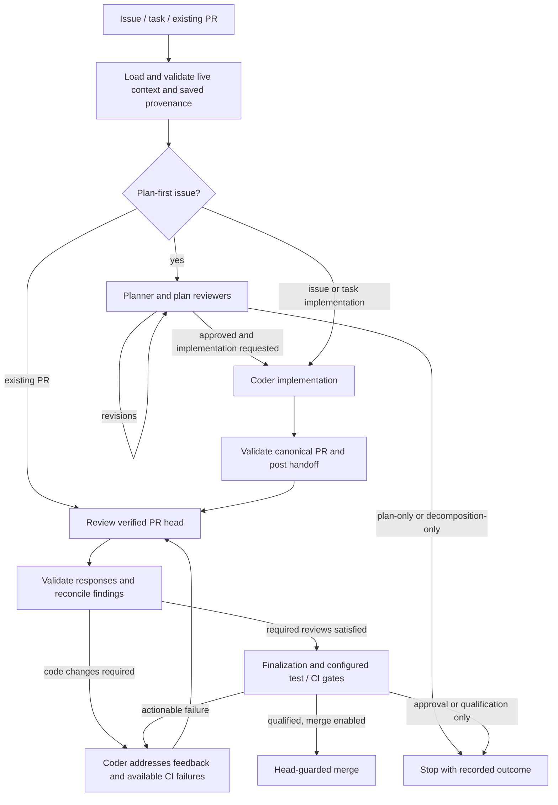

# Planning and implementation

The main lifecycle diagram and the plan-first path up to the implementation PR: the canonical approved plan and its handoff binding, the generation-1 risk-based mode and transition matrix and its inheritance by child plans, implementation evidence claims and their selector, row-ID and launcher rules, deterministic planning-validation recovery, and the generation-1 execution strategy with staged child phases.

Source paths: `src/coding_review_agent_loop/execution_retirement.py`, `tests/test_execution_decision_retirement.py`, `src/coding_review_agent_loop/plan_first_loop.py`, `src/coding_review_agent_loop/issue_implementation.py`, `src/coding_review_agent_loop/child_plan_binding.py`, `src/coding_review_agent_loop/execution_policy.py`, `src/coding_review_agent_loop/plan_assembly.py`, `src/coding_review_agent_loop/risk_coverage_map.py`, `src/coding_review_agent_loop/protocol.py`, `src/coding_review_agent_loop/test_runtime.py`, `src/coding_review_agent_loop/decomposition.py`, `src/coding_review_agent_loop/child_topology.py`, `src/coding_review_agent_loop/phase_progress.py`, `tests/test_plan_first_loop_review.py`, `tests/test_plan_first_loop_staged.py`, `tests/test_plan_first_loop_step_back.py`, `tests/test_plan_first_loop_execution_strategy.py`, `tests/test_issue_implementation_handoff.py`, `tests/test_issue_implementation_recovery.py`, `tests/test_issue_loop_resume.py`, `tests/test_plan_assembly.py`.

## Main Lifecycle

Every stage can also stop for a clarification, invalid or unavailable required
response, exhausted budget, or failed prerequisite. The arrows describe the
normal path, not permission to retry indefinitely or ignore failed checks.

## Planning and Implementation

Plan-first mode records a canonical approved plan and its identity. The
issue-to-PR handoff binds that plan to the implementation PR independently of
bounded issue-comment text. Direct PR resumes recover that binding when it
exists; an ordinary PR without planning provenance does not invent a plan.

Planning, implementation, reviewer, and repair invocations have separately
resolved model/effort settings. An implementation override must not implicitly
change the reviewer or repair backend. Issue creation and PR resume converge
on the shared PR loop after provenance validation.

Every plan and plan-revision prompt form (full, compact and semantic patch)
requires one `plan_steps` entry beginning `Smallest alternative:` that names the
smallest change that could resolve the issue, including removing or relaxing the
existing check that produces the bad outcome, and says `adopted` or why it was
rejected; an issue's prescribed design is a suggestion unless marked as a hard
requirement. Full and compact plan-review prompts tell reviewers to block on a
missing note, a weak rejection reason or a clearly sufficient rejected
alternative. This is prompt-only: no plan schema or validator change, so
historical and approved plans stay valid (#1628).

Stateful or multi-mode planning can add a generation-1 risk-based mode and
transition matrix. The matrix is a bounded structured contract with explicit
applicability, meaningful combinations, exclusions, stable matrix-local row IDs,
and execution ownership. Draft changes are auditable before approval; the
approved payload is immutable until a newly reviewed substantive replan. Round
metadata and its existing sidecar authenticate canonical structured bytes and a
payload-bound section boundary independently of rendered markdown. Prompts,
repair, skill mode, and PR resume consume the semantic payload first. Renderer
drift therefore does not invalidate authentic history; malformed, oversized, or
matrix-only hydration/rendering data closes only the matrix channel and leaves
an independently valid plan hash/subject available. Legacy records remain
resumable without fabricated obligations, and implementation evidence preserves
row-level incomplete and test-receipt caveats. During staged execution, the
approved topology assigns each applicable row to one owner: a generated child
enforces only its owned rows while retaining sibling, later, and final rows as
read-only pending obligations, and a separately planned child must link its
rows to inherited parent obligations or surface a provenance conflict. That
link is a field-classified preserve-or-strengthen contract, compared on exact
sanitized strings with no case or whitespace normalization: applicability is
ordered (`not-applicable` < `applicable` < `required`) and may only stay or
rise; every parent forbidden side effect must survive as an exactly equal
entry; the scenario coverage fields (entry path or mode, initial state, event,
expected outcome) must retain the parent text verbatim and may only extend it;
proposed test level and location may change but are always surfaced; the label,
scope links, ordering, child-local rows, and the execution owner are free. A
rejection names each weakened row and field with a route forward and fits the
plan-validation diagnostic bound by construction. Admissible differences are
reviewed deltas: child plan reviewers receive a deterministic parent-versus-child
coverage delta, recomputed on resume and never persisted, with a duty to block
any narrowing of coverage or test reachability. The same comparison runs inside
the child plan-first cycle, from both parent dispatch and the direct child
entry, as an orchestrator-owned bounded replan that is independent of structured
repair: a weakening candidate stays unpublished in memory, the planner is
re-invoked with the field-level diagnostic over the unchanged authenticated
base, and exhausting `MAX_INHERITED_MATRIX_REPLANS` persists one authenticated
plan-validation diagnostic record and stops deterministically before any
reviewer or implementation turn; the next invocation recovers that record for
its first planner turn. The same loop also absorbs deterministic plan-assembly
failures on every plan-first run and semantic-patch payload rejections: repair
may change only a semantic patch's envelope, so the recovered patch payload is
validated on its own before repair is considered. Any payload rejection (a
strict patch-schema failure including a missing or wrong kind, an unknown
prior-item disposition, or an invalid
human-requirement disposition), including one masked by an envelope error,
skips the repair model and becomes a replan diagnostic instead. Every plan prompt form carries the inherited obligations
through one shared lossless renderer that shows exactly the compared form. Both
prompt blocks fail closed rather than truncate: oversized parent obligations
stop child planning before any planner turn, and an oversized delta set rejects
the candidate into the replan loop. Parent dispatch, direct child invocation,
and both skill-runner PR-validation branches apply the same function.

A historical approved child plan that fails this comparison has two audited
recovery edges instead of a dead end. Before any implementation handoff, the
approval-to-implementation guard in the plan-first loop posts one plain audit
comment and re-enters the enforced, mechanically checked revision turn with the
diagnostic attributed to the orchestrator, no synthetic reviewer item, and a
latched complete board for the next round. After a handoff, issue routing judges
the handed-off plan through the shared admissibility helper before resolving
the canonical PR, and reopens planning only under a signed
`child-plan-supersession` record discovered on the child issue (exact keys,
standalone human signature, child/parent/stage identity, one record per
superseded plan hash). The record digest is carried in two optional planning
round-metadata fields, omitted from the encoding when absent, and
`authorized_replan_lineage` is the single authority that accepts only a chained,
digest-bound planner-round lineage starting from the superseded plan. On
approval the existing open PR is rebound by one atomic issue-side comment
holding the superseding issue-to-PR handoff record and a rebind audit record;
nothing is written on the PR, so no partial cross-side state exists.
Cross-side authentication compares the unchanged PR-side closing contract with
the closing-contract lineage base (the latest issue-side record that is not a
same-PR equal-ID plan replacement) and takes the plan hash from the latest
record; the closing-ID digest never identifies a plan replacement. The resolver
also keeps the most recent plan-changing handoff edge and its comment locator
independently of that base, so a later closing-ID superset never hides a rebind
from verification. One verifier,
`verify_child_plan_rebind`, runs at issue entry, at both PR-loop provenance
sites, and on the plan-identity-change branch of the PR qualification snapshot
(through a planning-child binding captured once per PR run), so an unverified or
inadmissible replacement never reaches review, final sweep, merge, or
managed-CI gates. Provenance and current-contract admissibility are separate
checks: how a plan became the binding is verified first on every entry path,
before any new signed authorization for that plan is accepted, so an unverified
replacement cannot be laundered while a verified one that later became
inadmissible can still be superseded. The complete-board latch for the round
that reviews such a revision is reconstructed on resume from durable state (the
supersession binding on the latest planner round, or the guard's audit comment
for the plan it revises), so a restart right after the revised round cannot
narrow the board. PR approvals stay keyed by plan hash and subject, so none
recorded before a rebind is carried.

The validated matrix wire schema is the canonical source for planner and
repair prompt key lists and minimal applicable/not-applicable examples. Repair
is bounded format recovery: it preserves a complete fresh matrix and rejects
missing or semantically inconsistent matrix content rather than inventing
scenarios. Fresh execution-recommendation integrity remains eligible for the
existing planner replay, while an unrecoverable absent or malformed fresh
matrix terminates after one planner response. That fail-fast path retains the
original validator diagnostic and candidate provenance and reuses the durable
planning-validation diagnostic handler; the rejected response is never stored
as canonical plan state.

Implementation and coder-follow-up responses own semantic facts only. Their
`risk_test_matrix_claims` name approved row IDs, invocation-local broker
`execution_ref` selectors, actual test identifiers and locations, workflow and
outcome assertions, forbidden-effect assertions, and bounded caveats. A
selector is an ephemeral lookup key, never a receipt citation; repeated
commands receive distinct keys and restored keys cannot be reused after a
restart.

Claims may also declare `test_level`, and a response may declare untestable rows
in `risk_test_matrix_coverage_gaps`. After the reported PR passes its
read-only guards, one post-acceptance gate in `issue_implementation.py` runs
`risk_coverage_map.check_coverage_map` against the PR's pushed head and sends at
most one same-session coverage re-ask naming the deficient rows (never through
repair or the retry budget). The final assessment, recomputed after semantic
correction, renders as a display-only coverage-map section; it guarantees
completeness and well-formedness only, is distinct from canonical evidence, and
does not change the persistence boundary. See `docs/local_agent_loop.md`.

The orchestrator owns canonical `risk_test_matrix_evidence`. After it
authenticates the reported PR and exact eventual tracked tree (and, for a
follow-up, reconciles the advanced PR head), one shared typed builder resolves
the closed current-turn catalog and complete local journal. It emits every
enforceable approved row exactly once in approved order, cites only
authoritative passing observations bound to the invocation and authenticated
head/tree, and retains failed, timed-out, stale, unbound, and restart-limited
observations as non-verified caveats. Missing or partial claims therefore
produce complete non-verified evidence rather than hiding the PR.

Format and selector defects receive bounded semantic-only correction. A
selector outside the current-turn catalog (a command string, a cross-turn
handle, or oversize text up to a hard cap) is a claim defect, not an envelope
defect: it is dropped with a caveat before authentication and becomes an
`unknown-execution-ref` diagnostic afterwards. One admissible selector may be
cited by several rows, since one wrapper run routinely covers several rows;
each row still verifies only on its own facts. Row-ID defects are likewise
claim defects: a claim whose `row_id` is outside the approved
enforceable set, absent, not a string, malformed (including finding- or
requirement-like forms), or claimed more than once is dropped -- every copy of
a duplicate, so no arbitrary copy becomes coverage -- with one bounded,
parser-derived degradation record on the claims carrier. A supplied approved
set is authoritative even when empty; only an omitted set is unscoped.
Derivation emits one diagnostic per dropped claim: the historical
`unapproved-row-claim` code for an unapproved ID, naming the claim's position,
and for every other record a `degraded-row-claim`
diagnostic keyed by the claim's element path, never by agent text; it emits no
canonical row for a dropped claim, and the affected approved row reads
`missing`. The one
reserved fatal row-ID case is a value beyond the 16,384-byte hard cap, which is
unbounded input. The remaining claim-scope defects are claim drops too,
each with one record: a claim that is not an object, an absent, empty
or ill-typed `execution_refs`, an admissible selector repeated within one
claim of eight or fewer refs, an unknown key, an ill-typed fact or one over the field bound, a
selector over the field bound when no catalog is supplied, and a
`risk_test_matrix_claims` value that is not an array, which keeps no claim and
records one field-scope drop. A claim with several defects keeps exactly one
record, and the row-ID rules win. Authority violations and hard bounds stay
fatal and are checked before any degradation, so a degradable defect never
masks them. An `execution_refs` list of more than eight well-typed refs is not
one of them: it is de-duplicated and trimmed to its first eight
distinct selectors, with a caveat naming the rest and a warning log, before any
authority check, so only kept selectors are evaluated or cited; the discarded
raw occurrences stay bounded by the dropped-value cap, and an unsuperseded
journal failure named only by a discarded selector still makes the row
incomplete, because the complete journal is scanned. The fatal set is: keys that name orchestrator-owned verification authority
(`status`, `evidence_citations`, `receipt_id`, `command`, `claim`), the row,
caveat and 16,384-byte caps, a dropped value whose compact JSON exceeds
the same byte bound (for a claim dropped only by a row-ID rule, which already
passed every per-field bound, only the discarded tail of an over-long fact list
is measured), catalog collisions, in-catalog selectors that are
non-passing or whose launch integrity is failing or unknown (real broker
handles, so selecting one is an authority decision), and legacy canonical
fields. The
catalog-authority rejections (collisions and non-passing or non-authoritative
selectors) never route to structured repair, since reformatting cannot change
them: the rejection names the failing launch condition(s) or outcome/provenance and carries the redacted, bounded command and observation timestamp, and the run stops once, naming the rejection as a
`semantic-evidence-rejection` rather than a repair timeout. Collisions, and every
caller that has not opted in, stop once as described. The approved-plan
implementation hand-off opts into exactly one coder re-ask for non-passing or
non-authoritative selector rejections: it quotes the sanitized, bounded
rejection, resumes the rejected acquisition's session when the provider supports
it, and requires a rerun and a citation from the re-ask turn's invocation-local
catalog, outside `agent_max_retries`, model fallback, and repair. A second
rejection stops with the same classification. A rejection exposed only by a
structured repair candidate, after normalization could not fix the envelope,
stops the repair chain on that candidate with no fallback model and takes the
same route (one opted-in re-ask, otherwise a `semantic-evidence-rejection`
stop), whatever the repair transport outcome (#999).

PR follow-ups and both initial and coverage-reask implementation acquisitions
opt into the same single semantic-evidence re-ask (#1738, #1768).
Structured report partition and strict citation workdir guards run inside the
validated acquisition, including normalized and repaired candidates. Only their
typed report refusals join the re-askable reasons; operational and authorization
errors retain existing handling. A scratch-input receipt remains inadmissible:
feedback requests admissible replacement evidence without hiding failures.
Guard and selector refusals share one allowance in either order, outside ordinary
retries. A repair-surfaced refusal stops repair and spends only an unused
allowance. A semantic refusal exposed by the post-repair observation-field
fallback takes that same route; dropping a malformed field cannot swallow a
refusal or reset the allowance. Correction resumes the acquisition session when available and uses
its own closed catalog. Only a fully validated replacement may publish progress
or settle findings; terminal rejection and pushed-head recovery remain intact.
Exhausted initial implementation correction is a pre-authentication acquisition
failure: no PR number is accepted or authenticated, no authorization audit or
handoff is published, and no coverage continuation or confirmed-PR diagnostic
is emitted. A remote unconfirmed PR may exist; operators must inspect it before
rerunning instead of automatically creating a replacement. Exhausted coverage
correction retains the invocation-failure discard and initial-result fallback.
The original PR is re-authenticated after accepted or discarded coverage re-asks,
so evidence binds to the refreshed head. Post-authentication validators remain
as defence in depth with existing managed-CI audit and confirmed-PR diagnostics.
Checkout and authorization failures never receive semantic correction.

One launch state is not an authority decision at parse time (#1659): a passing,
parent-observed selector whose only launch defect is `suite_start=unknown`
(wrapper bootstrap verified, inner command started), typically from a launcher
the probe does not recognize. It is kept and reaches post-authentication
derivation, which still refuses it: the row stays unverified, no receipt
citation is produced, and an `inadmissible-execution` diagnostic says the suite
start was never verified and names the citable runners. The run does not stop,
no re-ask budget is spent, and no repair runs, on the direct follow-up, the
implementation hand-off or a structured-repair candidate. Such a row also
carries the `suite-start-unverified` capture disqualifier, so it is
`not-capture-limited` and automatic evidence conversion never hands it to a
human: the coder can capture the check by wrapping it in a pytest test. Every
other failing launch state keeps the re-ask/stop route above. `run-tests`
prints a not-citable notice beside such a receipt, and the coder prompts list
the citable runners from the same shared summary.

Inner-launcher authentication also covers a local Playwright spelling:
`npx [--no-install|--no] playwright test ...` is recognized only when
`<cwd>/node_modules/.bin/playwright` exists, in which case both the bounded
`--version` probe and the real launch use that local binary (through the probe
result's `launch_argv`), while the recorded command keeps the npx spelling.
npx is never executed by the recognizer or probe. Any other npx option
(`-y`/`--yes`, `-p`/`--package`, `-c`, `--`, a version-pinned `playwright@x`),
the existing unsafe `playwright test` forms, and a non-empty `NODE_OPTIONS` or
`PW_TEST_REPORTER` (ambient or via an `env` prefix) leave the launcher
unrecognized, so the observation stays `suite_start=unknown`.

Package-script resolution extends the same contract to
`npm run|run-script <name> [-- args]`, `pnpm run <name>` and
`yarn run <name>`/`yarn <name>`. `<cwd>/package.json` (never an ancestor) is read
statically, once per request, and package.json logic is never executed. The
script is adopted only when its body is a single simple command the recognizer
already accepts; compound or shell-syntax bodies, a missing script, an existing
`pre<name>`/`post<name>`, manager options, pnpm/yarn trailing arguments, nested
package-manager or `env` bodies, an `node_modules/.bin` shadow of a bare head,
and an unrecognized body are discarded and the request runs exactly as before
with `suite_start=unknown`. The resolved argv is frozen once and is the only
input to worker policy, the probe, the launch, worker-report classification and
checkout-evidence admissibility; an adopted resolution never spawns the package
manager, and `ForegroundTestResult.args` and the broker/row `executed_argv` hold
the exact spawned target after launcher rebinding (excluding containment
wrappers). The recorded command and the input manifest keep the original
package-manager spelling. A package-manager observation without a live executed
command is never admissible evidence. Plain `node <file>` is not recognized; the
launch-integrity rejection instead names the exact `node --test <file>` spelling
when redaction left the file token untouched. Repair
does not generate matrix identities, canonical rows, receipt IDs, mappings,
statuses, or evidence envelopes. Derived evidence and diagnostics are the
durable replay artifact; live execution selectors are not. Historical accepted
canonical evidence remains readable for resume, while a fresh response that
contains legacy canonical fields cannot make those fields authoritative.

Decomposition into child phases and materialization of split proposals are
distinct workflows, with typed topology and durable checkpoints. They are not
inferred by creating an issue for every sentence mentioning deferred work.
See [decomposition boundaries](../local_agent_loop.md#phased-decomposition-versus-split-materialization).

### Deterministic planning-validation recovery

When a fresh plan or plan revision exhausts deterministic validation retries,
the orchestrator retains the final rejected candidate only in memory for its
digest and provenance. It writes one bounded planning-validation diagnostic
record to the issue only after resolving the authenticated actor and verifying
the returned comment body, numeric server comment identity, server creation
time, and producer identity. The immutable payload contains repository/issue
context, planning generation and target round, prior plan subject, contract
versions, expected producer identity, failure attempt, candidate digest,
deterministic category, and a sanitized diagnostic capped at 4096 characters.

Server-assigned identity and live body values are transport-wrapper metadata;
they are never encoded into or patched into the payload. On resume, live issue
comments are reauthenticated against the invocation actor and exact body,
then same-context records are ordered only by payload failure attempt. The
unique highest attempt is injected as trusted orchestration correction context
into initial, full, compact, and parallel planning prompts. Timestamps,
comment order, candidate-digest matching, issue prose, reviewer findings, and
human requirements do not select or authorize the diagnostic. A conflicting
highest attempt fails closed; stale, malformed, actor-mismatched, and legacy
records are ignored. A newly verified canonical coder plan comment semantically
supersedes matching diagnostics without deleting or rewriting history.

If actor lookup, posting, or wrapper verification fails, the original
validator diagnostic remains the terminal cause and the invalid candidate is
never accepted as canonical plan state. Provider, timeout, quota, marker-safety,
and containment failures are ineligible for this planning-only record.

### Generation-1 reviewed execution strategy

Fresh planning and revision turns carry `execution_strategy_contract_version: 1`
and a complete `execution_recommendation`. The recommendation owns stable
scope-item IDs, coupling constraints, one-shot or enriched staged deliveries,
and independent retained-parent/final-integration allocations. Coverage is
exactly once; dependencies are earlier-only; automation is one of
`agent-pr`, `human-action`, or `manual-close`. Unversioned historical plans
remain legacy-undecided and are never upgraded by inference or repair.

The recommendation is canonicalized into a bounded sidecar and round metadata,
so its strategy, topology, allocations, compatibility constraints, and caveats
participate in plan subject/hash identity and restart validation. A compact
execution decision records the parent, approved-plan identity, contract version,
canonical strategy/source, and complete recommendation digest; the lossless
recommendation remains in the approved plan record and its existing sidecars.
Explicit policies are checked against that recommendation before closure,
follow-up, split, child, handoff, or dispatch effects. Fresh staged summaries,
phase identities, and handoffs use the canonical `staged` strategy and fixed
`approved-plan-v1` source, while legacy summaries and phase identities retain
their exact requested-mode/source lookup and historical serialization. Stable
string stage IDs accompany one-based ordinals. Plan-only keeps its existing
approved-follow-up, requested split, and unfiled-scope behavior but does not
create a fresh execution decision or topology. The opt-in `auto` policy is
resolved only after approval: a fresh one-shot recommendation becomes
`implement-one-shot`, and a fresh staged recommendation becomes
`implement-by-phase`. Legacy-undecided plans and incompatible explicit pairs
fail closed before mutation. A typed resolved action drives follow-ups,
topology, handoffs, and dispatch; dry-run reports that action without
persistence or GitHub writes. The durable decision is written before any
follow-up, child, handoff, coder, or PR mutation, and staged execution is
bounded to one `agent-pr` child per run while the parent remains open.
Repair may preserve a complete v1 source, but cannot synthesize missing
recommendation data.

Execution re-approval uses `execution_retirement.py` and its strict inventory
reader to assess complete child and all-state PR listings plus every referenced
handoff, decomposition, checkpoint and split record. Callers supply the approved
split ownership derivation from execution policy, keeping retirement assessment
independent of that higher policy layer. A stale decision may be retired only when its work is absent
or positively terminal (CLOSED children; CLOSED or MERGED PRs), with confirmed
absence of the encoded reserved-branch endpoint. Unknown, truncated or unreadable
state fails closed. A leftover branch requires manual deletion after verifying
finished work; retirement never mutates old work or changes stage-completion rules.
Historical children from every record and inventory source also require terminal
implementation PRs: the assessment correlates child closing references and managed
branches, reads complete child comment histories, and authenticates canonical child
handoffs from every lineage, including earlier lineages displaced by a different
PR, even when their PRs are absent from listings. Each lineage retains its
same-PR contract supersession checks. Unreadable child histories
or PR references block retirement.
The existing decision records retired hashes and explains terminal supersession.

`issue_loop.py` defers only an authenticated terminal canonical handoff in
plan-first mode; approval must still prove retirement under a different plan.
Hash-less split materializations after a retiring decision belong to its current
one-shot plan only when the recovered approved plan permits every split key and
the materialization subject matches. Verified retired split keys suppress prior
discuss proposals, preserving completed work without recreating children. Legacy
plans without an execution recommendation repeat strict canonical handoff
resolution before execution writes; entry deferral alone provides no dispatch
authority. Plan-only runs with an authenticated terminal canonical handoff return
the approved plan without materializing split proposals or posting unfiled-scope
warnings, whether or not split materialization was requested.

Same-plan and direct-mode terminal recovery refuse. Restart rebuilds a read-only,
invocation-scoped execution history view before PR recovery and fresh preflights.
Current-plan records positively attribute children and PRs first, including the
current managed branch. Earlier hash-bearing records follow per-record retirement
ordering, preserving A/B/A recurrence. Hash-less records before a retirement
boundary and unclaimed parent-linked inventory may become history only after
terminal verification and complete inventory correlation. Reopened, ambiguous or
unattributed open work refuses. The view excludes individual historical record
spans and child identities from execution selection, preserves other comment
content and all durable records, and is carried through refetch, decomposition,
split discovery, canonical handoff and implementation recovery.

Staged decomposition returns an explicit topology outcome - the materialized
children, one resolved stage identity and automation per index, the run's own
approved-plan hash and mode, and the recorded retained-parent and
final-integration obligations - because the dispatcher cannot otherwise obtain
stage identity or obligations on the adopted and legacy paths, where a
recovered decomposition summary is the only source. A parent advancement state
machine consumes that outcome. Phase handoff records are first filtered to the
outcome's own plan hash and mode, then reconciled against the child mapping:
a missing or repeated child number, a record whose child or stage disagrees
with its index, a duplicate record for one index, a record for a human-owned
phase or an out-of-range index, and an ordered-prefix violation - a record for
a phase later than the first incomplete one - each stop the run before any
child state is read. Phases are then authenticated in order against live state.
Selection stops at the first incomplete phase, and so does resolution of later
`agent-pr` phases: with no recorded handoff there is nothing to authenticate,
so no child state or PR evidence is read for them. A later human-owned phase is
still resolved from its child issue state, because a human stage never carries
a phase handoff and closure is its only durable signal; a child an operator
closed ahead of its turn is reported as attested and still confers no authority
to skip the earlier phase. An `agent-pr` phase is
complete only when its child issue is CLOSED and its canonical issue-to-PR
handoff names a MERGED pull request, authenticated by the same identity, URL
and closing-contract checks that resume applies; an open child with a merged or
closed canonical PR, and a closed child with absent, unreadable or unmerged PR
evidence, both fail closed. A `human-action` or `manual-close` phase is
complete on closure of its child issue alone - that closure is the operator
attestation, and no PR evidence is read for it. The first incomplete phase is
dispatched through the existing child-dispatch seam with its real phase index;
an in-progress phase instead yields a runnable resume command for its still-open
child; and a fully complete topology yields a terminal report that distinguishes
agent-delivered stages from human-attested ones and names any operator-owned
retained-parent and final-integration work. Final-integration work is never
implemented automatically and the delivered parent is never closed
automatically. Dry run resolves no child state and issues no child GitHub
reads.

Each fresh staged child also carries a reviewed execution disposition. The
planner chooses `direct-implementation`, `requires-child-planning`, or the
automation-bound `human-owned` stop, and plan reviewers approve that semantic
claim. The orchestrator's routing seam validates typed readiness fields and
approved-parent provenance, applies at most one topology-valid signed override,
and otherwise fails ambiguous legacy metadata closed to planning. Overrides
cannot provide readiness evidence. Direct children bind implementation and PR
provenance to the parent phase; planning children persist a planning handoff
before invoking a child plan/review cycle and later bind their PR to that
reviewed child plan.

The phase handoff is the durable no-switch boundary. Its effective disposition
and optional override-record digest are reconciled identically during parent
preflight, direct child entry, PR recovery, and skill-mode recovery. An
override-bound mismatch is accepted only while the exact signed record remains
discoverable and matches the parent, plan, stage, and disposition; edited,
deleted, post-handoff, conflicting, or superseding records stop for human
repair. Human-owned stages bypass handoff reconciliation and preserve their
existing stop. A planning child that recommends another staged topology stops
before decision persistence or decomposition because hierarchical execution is
owned by separate work (see Decisions).

Direct child entry enforces the parent's staged order before it posts any
handoff or starts an agent turn. It runs the parent's staged-progress
resolution read-only over the earlier phases only, with the same completion
and integration-base verification minus the closure write; an undelivered
earlier phase stops the run with `DependencyNotMergedError` (exit code 5).
The decomposition summary's per-child relaunch lines are advisory operator
guidance and carry no protocol authority.

## Decisions

[Decision log](decisions/planning.md)
